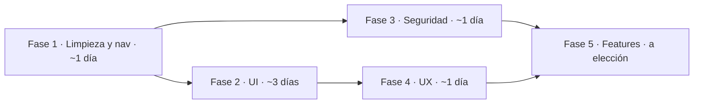

# Plan de mejora integral — pipaa.store

> **Para agentes:** SUB-SKILL REQUERIDA: usar superpowers:subagent-driven-development (recomendado) o superpowers:executing-plans para implementar este plan tarea por tarea. Los pasos usan checkbox (`- [ ]`).

**Objetivo:** Corregir los bugs de UI, limpiar todo lo que quedó desactivado, reorganizar las páginas para que cada una tenga un propósito claro y sumar features nuevas, sin romper la sala de directo ni Día Sub.

**Arquitectura:** Se mantiene React 19 + Vite multi-página + Cloudflare Worker con Durable Objects. Se parte `app/page.tsx` en una página por ruta con datos en `app/data/`, se consolidan las 4 capas de CSS que se pisan entre sí y se agregan features sobre el Worker existente.

**Stack:** React 19.2, Vite 8, TypeScript 5.9, Cloudflare Workers + DO (SQLite), lucide-react. Se suma `vitest` (dev) para la lógica pura.

**Spec:** este documento. La sección «Auditoría» es la fuente de cada tarea.

## Restricciones globales

- Idioma de la UI: español rioplatense (voseo). `lang="es-AR"` en todos los HTML.
- Paleta fija: `--ink #07050d`, `--violet #6d35db`, `--acid #a7ff00`, `--sky #75b9ff`, `--gold #ffd043`.
- Tipografía: Inter (texto) + Bebas Neue (display, **solo peso 400**).
- No cambiar las URLs públicas: `/`, `/directo/`, `/videos/`, `/perfil/`, `/comandos/`, `/api/*`.
- No tocar la verificación de firmas de Kick/Twitch en `src/dia-sub-webhooks.ts`.
- Verificación base de cada tarea: `npm.cmd run build` termina sin errores (en esta PC `npx`/`npm` necesitan el sufijo `.cmd` por la Execution Policy de PowerShell).
- Breakpoints a revisar a mano en cada tarea de UI: 360, 390, 768, 1440 px.

## Review Focus

1. **Usuario con `prefers-reduced-motion`**: hoy `universe.css` L105-109 vuelve a activar animaciones infinitas para ellos. Debe quedar todo quieto → test en Tarea 2.3.
2. **Teclado en el modal de video**: no cierra con Escape, no atrapa foco y la miniatura no es enfocable → test en Tarea 2.4.
3. **Portapapeles bloqueado** (iframe, http, permisos): `handleCopyCode` y `handleCopy` tiran error sin capturar → Tarea 2.5.
4. **Sábado que cambia a domingo con la sala abierta**: hoy se resuelve con un `setInterval` cada 1 s; al reemplazarlo hay que conservar el cambio exacto a las 00:00 ART → test en Tarea 4.2.
5. **Visitante que llega a `/comandos/` desde el sitio**: hoy es imposible, no hay ningún link → Tarea 1.3.

---

## Auditoría (lo que encontré)

### A. Cosas desactivadas que quedaron como código muerto

| Elemento | Dónde vive | Estado |
|---|---|---|
| Topbar fija con menú hamburguesa (`.topbar`, `.menu-toggle`, `.nav-live`, `.is-scrolled`) | globals.css L165-276, redesign.css | Reemplazada por `.channel-header`; CSS muerto |
| Ticker/cinta animada (`.ticker*`) | globals.css L891-937, redesign.css, universe.css L111-115 | Sin JSX |
| **Dock móvil inferior** (`.mobile-dock`, `.dock-item-live`, `.dock-item-troll`, `.dock-live-ping`) | globals.css | Sin JSX — era el acceso a `/comandos/` en celular |
| Gráfico de daño / performance board (`.damage-chart`, `.chart-*`) | globals.css | Sin JSX |
| Ledger oficial (`.official-ledger`, `.ledger-card`) | globals.css | Sin JSX |
| Stage de directo viejo (`.live-stage*`, `.player-shell`, `.player-corners`…) | globals.css L1122-1300+ | Reemplazado por `LiveHub` |
| Hero viejo (`.hero-character*`, `.hero-giant-text`, `.hero-visual*`, `.hero-badge`, `.vertical-type`) | globals.css L318-890 | Reemplazado por `Hero.tsx` |
| Cursor custom | `app/components/CustomCursor.tsx` (no se importa) + redesign.css L4 fuerza `cursor:auto!important` | Apagado |
| Reloj ARG / ventana de stream | `app/LocalTime.tsx` (importado y sin usar en page.tsx) | Apagado |
| Badges de YouTube (`.yt-duration-badge`, `.yt-views-pill`, `.yt-tab-badge`) | globals.css | La API no trae duración ni vistas |
| Intro de home vieja (`.home-intro*`), `.site-details`, `.room-write-menu` | live-hub.css | Sin JSX |
| Deep-dive de Dixper y simulador viejo (`.cmd-dixper-*`, `.cmd-simulator-*`, `.cmd-msg`, `.color-*`) | comandos.css | Sin JSX |
| `.argentina-portrait-type`, `.social-card`, `.career-item`, `.social-list` | redesign.css | Sin JSX |

Totales medidos: **globals.css ~77 de 276 clases sin uso**, comandos.css ~20, live-hub.css ~9, redesign.css ~20.
**Imágenes sin uso en `public/`: 11 archivos, ~9,9 MB** que se copian a `dist/` y se despliegan (`hero-pipaa-v2.png` 2,3 MB, `panza-army-3d.png` 2,3 MB, `pipaa-front-cutout.png` 2,2 MB, `pipaa-argentina-pnc-2026.png` 1,3 MB, `pipaa-portrait-glow.jpg` 625 KB, `hero-pipaa-3d.jpg` 455 KB, `pipa-argentina-2026.jpg` 158 KB, `og-v2.jpg`, `pipa-avatar.webp`, `pipa-banner.webp`, `youtube-latest.json`).
**Imports sin usar** (tsc `--noUnusedLocals`): `LocalTime`, `CalendarDays`, `Play`, `User` en page.tsx; `CommandItem`, `TwitchChannelReward`, `ArrowRight` en comandos/page.tsx.

### B. Bugs de UI

1. **`/comandos/` está huérfana**: ningún link del sitio lleva ahí. El FAQ dice «mirá la sección Tienda Troll» sin link y el botón «Ver Tienda de Comandos Troll» va a dixper.gg.
2. **Bebas Neue en negrita falsa**: Bebas solo existe en 400, pero hay 34 reglas con `font-weight:900` (incluido `h1,h2,h3`). El navegador sintetiza la negrita → bordes borrosos en todos los títulos.
3. **Numeración de secciones rota**: 01 → (Argentina sin número) → 03 → 04 → 05 → 06 → **10 → 11** → «07 LA COMUNIDAD» aparece al final.
4. **Home y Perfil son casi la misma página**: `/` renderiza todo el perfil completo (≈12 secciones) y `/perfil/` lo repite. Home pierde foco y Google ve contenido duplicado.
5. **Orden raro al final del perfil**: Contacto comercial aparece *antes* del POV oficial, el código de creador y la tarjeta de comunidad.
6. **Íconos de YouTube a 24 px**: `YouTubeFeed.tsx` usa clases tipo Tailwind (`w-4 h-4 text-acid`, `text-red-500`, `fill-current`) pero el proyecto no tiene Tailwind; solo `.cmd-shell` las parchea.
7. **Modal de video inaccesible**: sin `role="dialog"`, sin Escape, sin foco atrapado, sin bloqueo de scroll; la miniatura es un `div` con `onClick` (no se puede abrir con teclado).
8. **Overlay `.universe-signal`** (fijo, z-index 105) pinta borde + sombra interna *encima* del header (z-index 30) en todas las páginas.
9. **Reduced motion roto**: redesign.css apaga todo con `!important` y universe.css L105-109 vuelve a encender 3 animaciones infinitas con `!important` para esos mismos usuarios.
10. **9 animaciones infinitas simultáneas** (atmósfera, grid, signal, glitch, orbit, ring, portal, type-drift, signal-drift) → consumo de GPU/batería en celulares.
11. **Simulador de comandos**: `scrollIntoView` mueve toda la ventana en cada mensaje; «Probar en vivo» hace `scrollTo({top:500})` fijo; «Probar» desde la tienda cambia de pestaña pero no lleva al simulador.
12. **`playSoundEffect` crea un `AudioContext` nuevo por sonido y nunca lo cierra** → Chrome empieza a fallar tras varios clics.
13. **Filtros de precio por texto** (`priceArs.includes("150")`): el filtro «medio» existe en el estado pero no en la UI; cualquier cambio de precio rompe los filtros.
14. **Header de `/comandos/` distinto** al del resto (`cmd-topbar` vs `channel-header`): no hay forma de ir a Directo o Videos.
15. **Footer pobre**: sin redes, sin navegación, sin `/comandos/`.
16. **Contenido contradictorio**: FAQ dice «ex jugador profesional», el hero dice «jugador argentino de PUBG», la trayectoria lo muestra activo en 2026.
17. **Fuentes con `@import` dentro de globals.css** → cadena bloqueante (HTML → CSS → CSS de Google → fuente).
18. Estilos inline masivos en comandos/page.tsx (≈40 `style={{…}}`).

### C. Bugs técnicos / SEO / seguridad

1. `og:image` relativo (`../og-v3.jpg`) en directo/videos/perfil/comandos: el plugin solo normaliza `./og-v3.jpg`.
2. Misma `meta description` en todas las sub-páginas; `twitter:*` genérico.
3. Sitemap sin `/comandos/`; `public/robots.txt` y `public/sitemap.xml` se pisan en el build (archivos fuente inútiles).
4. Sin `Content-Security-Policy`.
5. Tabla `signups` de DiaSub crece para siempre.
6. `LivePlayers.tsx` lee `window.location.hostname` al importar el módulo.
7. `LiveHub` y `Hero` recalculan sábado con `setInterval` de 1 s.
8. `tsconfig.json` incluye archivos sueltos a mano: `CustomCursor.tsx` y cualquier archivo nuevo no importado queda sin chequear.
9. Sin tests. `scripts/check-mate-hunt.cjs` existe pero no hay script npm.
10. 7 archivos `.md` de prompts/notas en la raíz del repo.

---

## Decisiones que necesito de vos (antes de la Fase 1)

| Elemento desactivado | Propuesta por defecto |
|---|---|
| Dock móvil inferior | **Reactivar** rediseñado (Inicio · Directo · Videos · Comandos), resuelve el bug B1 en celular |
| Reloj ARG / horario de stream | **Reactivar** dentro del hero como «Próximo directo 15:00 ARG / En horario de stream» |
| Ticker | Borrar |
| Cursor custom | Borrar (rompe accesibilidad y está forzado a `auto`) |
| Gráfico de daño y ledger | Borrar ahora; vuelven con datos reales en la Feature 5.1 |
| Imágenes sin uso | Mover a `assets-archive/` fuera de `public/` (no se borran) |

---

## Estructura de archivos resultante

```
app/
  data/            career.ts, pnc.ts, arsenal.ts, settings.ts, setup.ts, faqs.ts, sources.ts, socials.ts
  pages/           Home.tsx, Perfil.tsx, Videos.tsx, Directo.tsx
  layout/          SiteHeader.tsx, SiteFooter.tsx, MobileDock.tsx, SiteShell.tsx
  sections/        Intro.tsx, Argentina.tsx, StreamLab.tsx, Career.tsx, Arsenal.tsx, Setup.tsx,
                   Faq.tsx, Sources.tsx, Community.tsx, Contact.tsx
  hooks/           useArgentinaDay.ts, useCopy.ts, useLiveStatus.ts (movido)
  styles/          tokens.css, base.css, layout.css, components.css, sections.css, motion.css
  comandos/        (se mantiene; se le quitan inline styles)
src/main.tsx       router por pathname → React.lazy por página
tests/             argentina-date.test.ts, dia-sub-snapshot.test.ts, useArgentinaDay.test.ts
```

---

## Fase 1 — Limpieza y navegación (rápido, bajo riesgo)

### Task 1.1: Borrar código muerto e imports sin uso

**Files:** Modify `app/globals.css`, `app/redesign.css`, `app/universe.css`, `app/live-hub.css`, `app/comandos/comandos.css`, `app/page.tsx:5,25,35,36`, `app/comandos/page.tsx:6,11,45`. Delete `app/components/CustomCursor.tsx`. Move los 11 archivos de la auditoría A a `assets-archive/`. Delete `public/robots.txt`, `public/sitemap.xml`.

- [ ] Borrar cada bloque de la tabla A que la decisión marque «Borrar» (conservar `.mobile-dock*` y `.arg-clock*`/`.status-badge*` si se reactivan).
- [ ] Ejecutar `node <scratch>/deadcss.cjs .` (script de esta auditoría) — esperado: ≤ 5 clases sin uso por archivo, todas dinámicas (`tier-*`, `tag-*`, `effect-*`, `is-kick`).
- [ ] Ejecutar `npx.cmd tsc --noEmit --noUnusedLocals --noUnusedParameters` — esperado: 0 errores.
- [ ] `npm.cmd run build` y medir `dist/`: esperado ≥ 9 MB menos que antes.
- [ ] Commit `chore: remove dead CSS, unused components and 9.9MB of unused images`.

### Task 1.2: Corregir tipografía Bebas

**Files:** Modify las 34 reglas con `font-weight:900`/`font:900` que usan `var(--font-display)`; `app/globals.css:6` (import).

- [ ] Reemplazar 900 → 400 en todas las reglas con `--font-display`; dejar 900 solo donde la familia es Inter.
- [ ] Sacar el `@import` de globals.css y poner en los 5 HTML: `<link rel="preconnect">` (ya está) + `<link rel="stylesheet" href="https://fonts.googleapis.com/css2?family=Inter:wght@400;500;600;700;800&family=Bebas+Neue&display=swap">`.
- [ ] Verificar en 1440 px: los h2 de las secciones se ven nítidos (sin borde engrosado).
- [ ] Commit `fix(ui): use real Bebas Neue weight and non-blocking font load`.

### Task 1.3: Navegación unificada (header, footer, dock)

**Files:** Create `app/layout/SiteHeader.tsx`, `app/layout/SiteFooter.tsx`, `app/layout/MobileDock.tsx`, `app/data/socials.ts`. Modify `app/page.tsx:211-218,843-849`, `app/comandos/page.tsx:366-380,1280-1291`.

**Interfaces:**
- Produces: `NAV_ITEMS: readonly { href: "/" | "/directo/" | "/videos/" | "/perfil/" | "/comandos/"; label: string }[]` en `app/layout/SiteHeader.tsx`; `SiteHeader({ current }: { current: string })`; `SiteFooter()`; `MobileDock({ current, live }: { current: string; live: boolean })`; `SOCIALS` en `app/data/socials.ts`.

- [ ] `NAV_ITEMS` = Inicio, Directo, Videos, Perfil, **Comandos**.
- [ ] `SiteHeader` reemplaza el header inline de page.tsx **y** el `cmd-topbar` de comandos.
- [ ] `MobileDock` visible solo `max-width: 768px`, fijo abajo, `padding-bottom: env(safe-area-inset-bottom)`, punto verde pulsante en «Directo» si `live`. Reusar estilos `.mobile-dock*` existentes. Agregar `padding-bottom` al `main` para que no tape contenido (y para que `.mate-notice` quede encima).
- [ ] `SiteFooter`: logo, NAV_ITEMS, SOCIALS, Dixper/WeezyX, © año actual.
- [ ] FAQ «Tienda Troll» y botón «Ver Tienda de Comandos Troll» → `href="/comandos/"`.
- [ ] Verificar: desde cada una de las 5 páginas se llega a las otras 4 en 1 clic, en 360 px y 1440 px.
- [ ] Commit `feat(nav): shared header/footer, mobile dock and link to /comandos/`.

### Task 1.4: SEO de sub-páginas

**Files:** Modify `directo/index.html`, `videos/index.html`, `perfil/index.html`, `comandos/index.html`, `index.html` (todos: `lang="es-AR"`), `vite.config.ts:107,135`.

- [ ] Descriptions únicas (copiar tal cual):
  - `/directo/`: «Mirá a PIPAA en vivo: reproductor de Kick y Twitch, multichat unificado y la lista de Día Sub de los sábados.»
  - `/videos/`: «Videos y directos anteriores de PIPAA en YouTube: PUBG competitivo, Nations Cup y momentos con la Panza Army.»
  - `/perfil/`: «Trayectoria, Selección Argentina, arsenal, setup dual PC y configuración de PUBG de PIPAA.»
  - `/comandos/`: «Comandos troll, precios en pesos, recompensas de Twitch y simulador de chat del canal de PIPAA.»
- [ ] Regex del plugin: `/(['"])(?:\.{1,2}\/)?og-v3\.jpg(['"])/g` ya cubre `../` — verificar en `dist/directo/index.html` que `og:image` sea `https://pipaa.store/og-v3.jpg`; si no, corregir el regex.
- [ ] Agregar `"comandos"` a la lista del sitemap.
- [ ] Verificar con `Select-String dist\*\index.html -Pattern 'og:image|description'`.
- [ ] Commit `fix(seo): unique descriptions, absolute og:image, sitemap includes comandos`.

---

## Fase 2 — Correcciones de UI

### Task 2.1: Separar Home de Perfil

**Files:** Create `app/data/*.ts` (mover los arrays de page.tsx L39-162), `app/sections/*.tsx` (una por sección actual), `app/pages/Home.tsx`, `app/pages/Perfil.tsx`, `app/pages/Videos.tsx`, `app/pages/Directo.tsx`. Modify `src/main.tsx`. Delete `app/page.tsx` al final.

**Interfaces:**
- Produces: `src/main.tsx` elige página con `React.lazy` según `location.pathname.replace(/\/?$/, "/")`; fallback `<div className="page-loading" aria-busy="true" />`.

- [ ] **Home** = Hero → Últimos videos (3) → bloque «Intro» resumido (facts +9h / #5 / 7+) → tarjeta Argentina compacta con link a `/perfil/#argentina` → Comunidad/Discord → Código de creador → Redes.
- [ ] **Perfil** = Intro → Argentina → Stream Lab → Trayectoria → Arsenal → Setup → FAQ → Archivo → POV → Comunidad → Contacto comercial (**contacto al final**).
- [ ] Renumerar kickers en orden visual real: 01 El fenómeno, 02 Argentina, 03 Stream Lab, 04 Trayectoria, 05 Arsenal, 06 Setup, 07 FAQ, 08 Archivo, 09 Comunidad.
- [ ] Mates escondidos: mantener los 3 IDs (`trayectoria`, `setup`, `comunidad`) en Perfil y avisar en Home «Hay 3 mates en el perfil».
- [ ] `npm.cmd run build`: el chunk JS de `/directo/` no debe contener `weaponsArsenal` (verificar con `Select-String dist\assets\*.js -Pattern 'BERYL'` → solo en el chunk de Perfil).
- [ ] Commit `refactor: split monolithic page into per-route lazy pages and sections`.

### Task 2.2: Consolidar CSS

**Files:** Create `app/styles/{tokens,base,layout,components,sections,motion}.css`. Delete `globals.css`, `redesign.css`, `universe.css` (contenido migrado). Keep `live-hub.css`, `hero-layered.css`, `mate-hunt.css`, `comandos.css` como CSS de componente.

- [ ] Una sola definición por selector (hoy `.topbar nav a::after`, `.section-grid`, `.contact`, `.ticker`, `:root` están definidos 2-3 veces).
- [ ] Eliminar todos los `!important` salvo los de `motion.css` reduced-motion.
- [ ] `.universe-signal` debajo del header: z-index < 30, o limitarlo a `main`.
- [ ] Verificar visualmente las 5 páginas en 4 breakpoints contra capturas tomadas antes de empezar (guardar en `docs/screenshots/before/`).
- [ ] Commit `refactor(css): consolidate four overlapping stylesheets into layered files`.

### Task 2.3: Movimiento y rendimiento

**Files:** Modify `app/styles/motion.css`, `app/ExperienceLayer.tsx`.

- [ ] Bajo `prefers-reduced-motion: reduce`: **ninguna** animación infinita (borrar las reglas que hoy las re-activan).
- [ ] Pausar animaciones decorativas cuando `document.hidden` (clase `is-paused` en `<html>` + `animation-play-state: paused`).
- [ ] En `max-width: 768px` dejar como máximo 3 animaciones infinitas (type-drift, atmósfera, live-dot).
- [ ] Test manual: DevTools → Rendering → «Emulate prefers-reduced-motion: reduce» → Performance 5 s sin frames de animación.
- [ ] Commit `fix(a11y): honor reduced motion and cut idle animations on mobile`.

### Task 2.4: YouTubeFeed accesible y con íconos correctos

**Files:** Modify `app/YouTubeFeed.tsx`, `app/styles/components.css`. Create `app/components/VideoModal.tsx`.

**Interfaces:** Produces `VideoModal({ videoId, title, onClose }: { videoId: string; title: string; onClose: () => void })` usando `<dialog>` nativo con `showModal()`.

- [ ] Reemplazar clases Tailwind por prop `size` de lucide (`<Film size={16} />`).
- [ ] Miniatura → `<button type="button" aria-label={`Reproducir ${title}`}>`; `alt=""` en la imagen (el título ya está en el h3).
- [ ] `VideoModal`: Escape cierra (nativo de `<dialog>`), foco vuelve a la miniatura que lo abrió, clic en backdrop cierra, `title` del iframe = título del video, iframe con `youtube-nocookie.com`.
- [ ] Skeleton de 3/12 tarjetas mientras carga en lugar del texto «Sincronizando…».
- [ ] Verificar con teclado: Tab → Enter abre → Escape cierra → foco en la misma tarjeta.
- [ ] Commit `fix(ui): accessible video modal and correctly sized icons`.

### Task 2.5: Copiar al portapapeles robusto

**Files:** Create `app/hooks/useCopy.ts`. Modify `app/sections/Community.tsx` (código creador), `app/LiveHub.tsx:60-67`, `app/comandos/page.tsx:300-304`.

**Interfaces:** Produces `useCopy(): { copied: string | null; copy: (id: string, text: string) => Promise<boolean> }` — resetea `copied` a los 2000 ms, devuelve `false` si `navigator.clipboard` falla.

- [ ] Si falla: mostrar «Copialo a mano: PIPAA» en un `role="status"`.
- [ ] Commit `fix: shared clipboard hook with failure fallback`.

### Task 2.6: Página de comandos

**Files:** Modify `app/comandos/page.tsx`, `app/comandos/commandsData.ts`, `app/comandos/comandos.css`.

- [ ] Un solo `AudioContext` reutilizable (lazy, módulo), `resume()` antes de sonar.
- [ ] Feed del simulador: `feedRef.current.scrollTop = feedRef.current.scrollHeight` en lugar de `scrollIntoView`.
- [ ] «Probar» y «Probar en vivo» → `document.getElementById("simulador")?.scrollIntoView({ block: "center" })` tras cambiar de pestaña.
- [ ] En `commandsData.ts` agregar `priceArsValue: number` (0 = gratis) y `PRICES_UPDATED_AT = "2026-11-19"`; filtros por rango numérico: bajo `< 1000`, medio `1000–3000`, alto `> 3000`; mostrar el filtro «medio» y la leyenda «Precios actualizados al 19/11/2026».
- [ ] Pestaña activa en la URL (`#tienda` / `#chat`) para poder compartir link directo.
- [ ] Mover los ~40 `style={{}}` a clases en comandos.css.
- [ ] Commit `fix(comandos): audio leak, scroll jumps, numeric price filters`.

### Task 2.7: Consistencia de contenido

**Files:** Modify `app/data/faqs.ts`, `app/sections/Intro.tsx`, `app/components/Hero.tsx`.

- [ ] Elegir un estado único (decisión tuya: «jugador profesional activo» o «ex profesional y streamer») y aplicarlo en hero, FAQ, Schema.org (`vite.config.ts:18`) y footer.
- [ ] Commit `docs(content): consistent player status across site`.

---

## Fase 3 — Seguridad y backend

### Task 3.1: CSP y headers

**Files:** Modify `src/worker.ts:69-82`, `public/_headers`.

- [ ] Agregar en respuestas HTML: `Content-Security-Policy: default-src 'self'; script-src 'self' https://www.googletagmanager.com; style-src 'self' 'unsafe-inline' https://fonts.googleapis.com; font-src https://fonts.gstatic.com; img-src 'self' data: https://i.ytimg.com; frame-src https://player.kick.com https://player.twitch.tv https://www.youtube-nocookie.com https://unified-chat.com; connect-src 'self' https://www.google-analytics.com; frame-ancestors 'self'`.
- [ ] El snippet inline de gtag (vite.config.ts L99) rompe con esta CSP → moverlo a `public/gtag-init.js`.
- [ ] Verificar con `npm.cmd run dev:worker`: consola sin violaciones CSP en las 5 páginas, reproductor Kick/Twitch y modal de YouTube funcionan.
- [ ] Commit `feat(security): content security policy`.

### Task 3.2: Purga de Día Sub + tests de fechas

**Files:** Modify `src/dia-sub.ts`, `src/worker.ts:9-11`, `package.json`. Create `tests/argentina-date.test.ts`, `vitest.config.ts`.

**Interfaces:** Produces `DiaSub.purge(now: number): void` — borra `signups` con `date` < 12 semanas atrás.

- [ ] Tests (`vitest`):
  - `saturdayFor(Date.parse("2026-11-21T03:00:00Z"))` → `{ date: "2026-11-21", isSaturday: true }` (00:00 ART del sábado).
  - `saturdayFor(Date.parse("2026-11-22T02:59:59Z"))` → `isSaturday: true`.
  - `saturdayFor(Date.parse("2026-11-22T03:00:00Z"))` → `{ date: "2026-11-21", isSaturday: false }`.
- [ ] Llamar `queue(env).purge(Date.now())` desde `scheduled` una vez por día (cuando `new Date().getUTCHours() === 6 && minutes < 10`).
- [ ] Script `"test": "vitest run"` en package.json.
- [ ] Commit `feat(diasub): purge old signups; add date tests`.

### Task 3.3: Detalles técnicos menores

**Files:** `app/LivePlayers.tsx:5-12`, `tsconfig.json:21`, raíz del repo.

- [ ] Construir la URL de Twitch dentro del componente.
- [ ] `tsconfig.include`: `["src", "app", "tests", "vite.config.ts"]`.
- [ ] Mover `ARGENTINA-PORTRAIT.md`, `IMAGE-PROMPTS.md`, `IMAGE-REFRESH.md`, `MATE-HUNT.md`, `PLAN-REDISENO.md`, `PORTRAIT-PROMPT.md` a `docs/notes/`. Actualizar README (sección «Estructura» hoy menciona `app/page.tsx`).
- [ ] Commit `chore: typecheck whole app, tidy repo root`.

---

## Fase 4 — Mejoras de experiencia

### Task 4.1: Reactivar el reloj ARG en el hero

**Files:** Modify `app/LocalTime.tsx`, `app/components/Hero.tsx`.

- [ ] Mostrar debajo de los CTAs: si `live` → nada (ya hay badge «En vivo»); si 15–24 h ART y no live → «Horario de stream · puede arrancar en cualquier momento»; si no → «Próximo directo hoy 15:00 ARG (tu hora: HH:MM)» calculado con `Intl` en la zona del visitante.
- [ ] Commit `feat(hero): next-stream clock in viewer timezone`.

### Task 4.2: Hook `useArgentinaDay`

**Files:** Create `app/hooks/useArgentinaDay.ts`, `tests/useArgentinaDay.test.ts`. Modify `app/LiveHub.tsx:237-252`, `app/components/Hero.tsx:11-15`.

**Interfaces:** Produces `useArgentinaDay(): { date: string; isSaturday: boolean }` — un `setTimeout` hasta la próxima medianoche ART (+1 s), re-evalúa en `visibilitychange`.

- [ ] Test con fake timers: montar a las 23:59:58 ART del sábado → `isSaturday true`; avanzar 3 s → `false`.
- [ ] Commit `perf: replace 1s interval with midnight timer`.

### Task 4.3: Estados vacíos y de error con diseño

**Files:** `app/LiveHub.tsx`, `app/YouTubeFeed.tsx`, `app/components/Hero.tsx`.

- [ ] Componente `EmptyState({ icon, title, action })` para: chat sin mensajes, YouTube caído, Día Sub sin inscriptos, PIPAA offline en el reproductor (overlay «PIPAA está offline · Ver último video»).
- [ ] Commit `feat(ui): designed empty and error states`.

---

## Fase 5 — Features nuevas (cada una es un plan propio cuando se apruebe)

| # | Feature | Qué hace | Base existente |
|---|---|---|---|
| 5.1 | **Stats reales de PUBG** | Cron cada 30 min contra la API oficial de PUBG (`PUBG_API_KEY`), guarda en un DO; reemplaza los números fijos (617,9 m, 21 % HS) y revive el gráfico de daño con datos reales | CSS `.damage-chart` ya existe |
| 5.2 | **Aviso a Discord al prender** | En `setStream(live=true)` postear embed a `DISCORD_WEBHOOK_URL` (con anti-duplicado de 30 min) | Webhooks Kick/Twitch ya llegan |
| 5.3 | **Notificaciones push** | Service Worker + Web Push (VAPID) «PIPAA está en vivo» / «Abrió Día Sub» | `site.webmanifest` |
| 5.4 | **PWA instalable + offline** | SW con cache de la shell y página offline | Manifest ya existe |
| 5.5 | **Agenda / próximos eventos** | Bloque en Home con torneos y eventos (JSON en KV editable sin deploy) + countdown | — |
| 5.6 | **Historial de Día Sub** | `/directo/#diasub` con selector de sábados anteriores y «tu racha» buscando tu usuario | Datos ya en SQLite |
| 5.7 | **Clips destacados** | Sección en `/videos/` con clips de Kick/Twitch curados | YouTubeFeed |
| 5.8 | **Mate Hunt v2** | Más mates (en Videos y Comandos), insignia compartible como imagen | MateHunt.tsx |
| 5.9 | **Panel admin** | `/admin/` con Cloudflare Access: estado de webhooks, cuota YouTube, inscriptos | Worker |
| 5.10 | **Encuestas en vivo** | Votación desde la sala de directo, resultados en tiempo real | DO DiaSub |

---

## Orden y esfuerzo estimado


